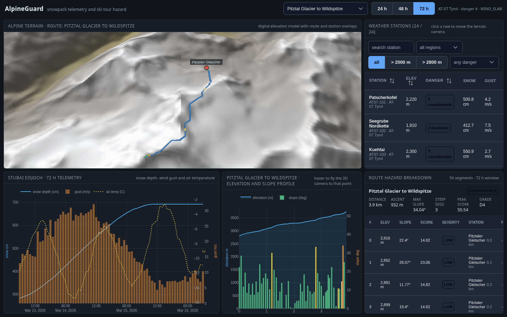
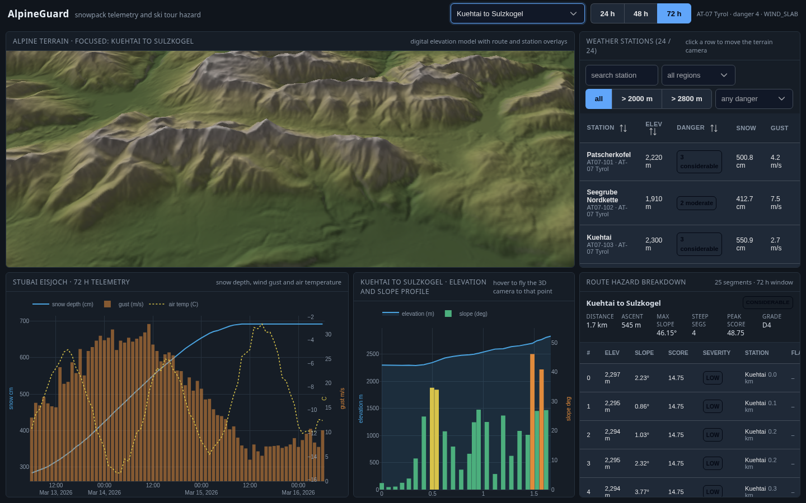
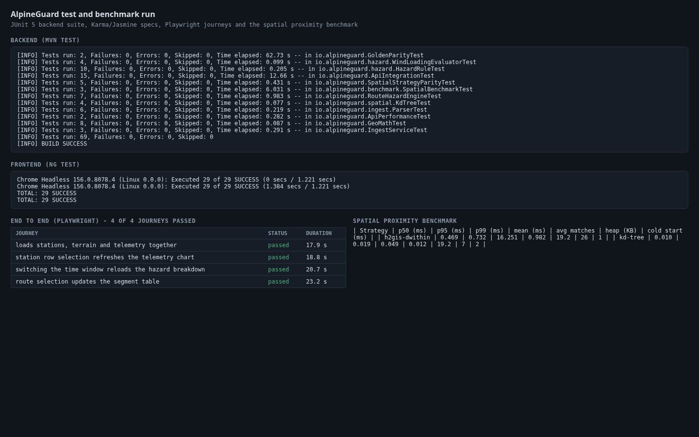
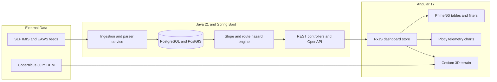

# AlpineGuard

AlpineGuard combines avalanche bulletins, hourly weather station telemetry and GPX ski tours
into one dashboard: a 3D terrain view, a filterable station browser and synchronized time-series
charts. A Spring Boot service normalizes the EAWS / SLF feeds, scores each tour segment against
slope angle, wind loading and the current danger rating, and serves the result as JSON and GeoJSON.

## Screenshots



3D alpine terrain with the Pitztal ski tour draped on the surface, next to the station browser and the 72 hour snowpack charts.



Sulzkogel tour selected: the Plotly elevation and slope profile drives the segment hazard table on the right.



Backend, frontend and end to end results with the proximity benchmark table.

## Quick Start

```bash
docker compose up --build -d
curl -fsS http://localhost:8080/actuator/health
curl -fsS "http://localhost:8080/api/v1/routes/pitztal-wildspitze/hazard-assessment" | head -c 400
```

The dashboard is served at `http://localhost:4200`, the API at `http://localhost:8080/api/v1`,
and the OpenAPI UI at `http://localhost:8080/swagger-ui.html`.

## Usage Example

```bash
curl -s "http://localhost:8080/api/v1/routes/sulzkogel-kuehtai/hazard-assessment?windowHours=72" \
  | jq '{severity, maxScore, maxSlopeDeg, steepSegmentCount, firstSegment: .segments[0]}'
```

```json
{
  "severity": "CONSIDERABLE",
  "maxScore": 48.75,
  "maxSlopeDeg": 46.15,
  "steepSegmentCount": 4,
  "firstSegment": { "index": 0, "slopeDeg": 2.23, "score": 14.75, "severity": "LOW" }
}
```

In the dashboard:

1. Pick a tour in the header dropdown; the globe frames the track and the hazard table lists its segments.
2. Click a station row to fly the camera to that station and load its telemetry.
3. Switch the time window (24 / 48 / 72 h) to rescore the route against a shorter weather history.
4. Hover the elevation profile to move the 3D camera to that point on the track.

## Architecture



## Configuration

| Variable | Default | Description |
| --- | --- | --- |
| `ALPINEGUARD_DB_URL` | `jdbc:h2:mem:alpineguard` | JDBC URL; compose sets the PostgreSQL 16 + PostGIS instance |
| `ALPINEGUARD_DB_USER` | `sa` | Database user |
| `ALPINEGUARD_DB_PASSWORD` | empty | Database password |
| `ALPINEGUARD_SPATIAL_STRATEGY` | `kd-tree` | Default proximity strategy (`kd-tree` or `postgis`) |
| `ALPINEGUARD_PROXIMITY_RADIUS_M` | `5000` | Radius used to attach a station reading to a route segment |
| `ALPINEGUARD_STEEP_SLOPE_DEG` | `30` | Slope angle that raises the steep slope flag |
| `ALPINEGUARD_LEE_TOLERANCE_DEG` | `45` | Angular tolerance for lee side wind loading |
| `ALPINEGUARD_WIND_LOADING_GUST_MS` | `12` | Gust speed that counts as snow transport |
| `ALPINEGUARD_SEED_ON_STARTUP` | `true` | Load the bundled feeds when the station table is empty |
| `ALPINEGUARD_TELEMETRY_TTL` | `60` | Telemetry cache lifetime in seconds |
| `ALPINEGUARD_HAZARD_TTL` | `30` | Hazard assessment cache lifetime in seconds |
| `ALPINEGUARD_BENCH_STATIONS` | `250` | Station count used by the benchmark harness |
| `SERVER_PORT` | `8080` | HTTP port of the backend |

## Running Tests

```bash
cd backend && mvn verify                                   # JUnit 5, Checkstyle, SpotBugs, JaCoCo line rate
cd frontend && npm test                                    # Karma / Jasmine specs
cd frontend && npx ng build                                # production bundle and budgets
npm install && npx playwright test                         # end to end journeys and screenshots
cd backend && curl -s http://localhost:8080/api/v1/benchmark | jq   # proximity benchmark
```

The Testcontainers repository test runs against `postgis/postgis:16-3.4` and is skipped when no
Docker daemon is available. `docs/spatial-query-comparison.md` holds the recorded benchmark run.

## Project Layout

```
backend/            Spring Boot service (Java 21, Maven)
  src/main/java/io/alpineguard/
    api/            REST controllers, DTOs and GeoJSON builders
    benchmark/      PostGIS versus k-d tree harness
    hazard/         Slope, wind loading and elevation band rules
    ingest/         EAWS / SLF feed parsers, GPX reader, seed loader
    repository/     JDBC repositories
    spatial/        Proximity strategies and the in-memory tree
  src/main/resources/db/migration/   Flyway migrations per vendor
  src/main/resources/seed/           Bundled station, reading, bulletin and GPX data
  src/test/                          Unit, integration and golden parity tests
frontend/           Angular 17 dashboard (PrimeNG, Plotly, Cesium)
  src/app/core/     Typed models, API client, RxJS store, chart and geo helpers
  src/app/components/
  public/terrain/   Heightmap and hillshade tiles built from the Copernicus DEM
e2e/                Playwright journeys, screenshot capture, static server
tools/              DEM tile builder, dataset builder, test report renderer
docs/               Architecture notes, ADRs, benchmark report, screenshots
```
